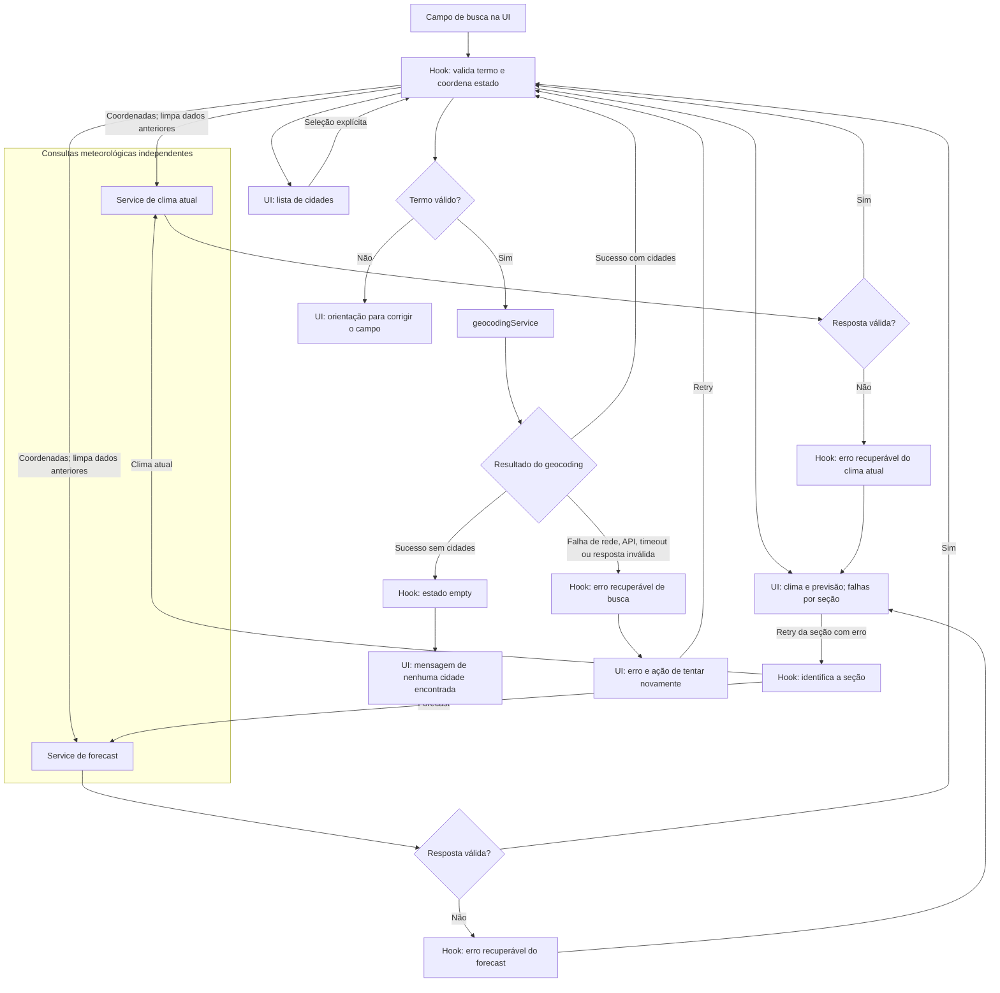

# Plano Técnico — Weather App

Fonte de verdade: [especificação do Weather App](../specs/weather-app-spec.md). Este documento define decisões e contratos para orientar a implementação; não contém o código final.

## Architecture

Aplicação web React organizada em camadas simples, com dependências apontando da apresentação para a orquestração e desta para os serviços. `components` não acessam a Open-Meteo: `hooks` coordenam ações e estado, `services` fazem I/O, e `lib` concentra transformações puras reutilizáveis. A resposta externa é validada e normalizada antes de chegar à interface.

```text
Pessoa usuária
      │ eventos e apresentação de estado
      ▼
components/ ── props ──► hooks/ (estado e orquestração)
                              │ chamadas tipadas
                              ▼
                         services/ ── HTTPS ──► Open-Meteo
                              │
                              ├── I/O e erros de transporte
                              ▼
                            lib/ (validação e funções puras)
                              │ modelos de domínio
                              └──────────────────────► hooks/ ──► components/
```

- `App` compõe a tela; componentes de apresentação exibem busca, resultados, clima atual, previsão e estados acessíveis, sem conhecer endpoints ou formatos da API.
- `hooks` coordenam busca, seleção, unidade, loading/erro/vazio, retries e concorrência; são a fronteira entre eventos da UI e operações dos serviços.
- `services` encapsulam `fetch`, URL/parâmetros, timeout/cancelamento e classificação de falhas de transporte. Chamam funções de `lib` para validar e converter payloads, retornando modelos de domínio ou erros explícitos.
- `lib` contém funções sem efeitos colaterais para normalização/validação de payloads, conversão de temperatura, mapeamento de códigos meteorológicos e regras de data/fuso.
- A busca e as consultas de clima atual e previsão são operações separadas. A seleção de cidade inicia as duas consultas meteorológicas sem que a falha de uma impeça o resultado da outra.
- A UI recebe somente modelos de domínio e estados explícitos; nenhum componente interpreta respostas brutas da Open-Meteo.
- Requisições obsoletas não podem sobrescrever resultados recentes. A seleção de outra cidade limpa imediatamente os dados da cidade anterior.

**Rastreabilidade:** RF1–RF6; RNF2–RNF4; AC1.6, AC2.2, AC7.4–AC7.6.

## Tech Stack

- **TypeScript strict, React e Vite:** stack estabelecida pelo projeto, adequada à aplicação web responsiva e aos tipos de domínio explícitos.
- **Tailwind CSS:** estilos mobile-first conforme o tema e a stack do projeto; controles devem permanecer operáveis por teclado e tecnologias assistivas.
- **Vitest e Testing Library:** testes unitários e de componentes; **Playwright:** fluxos ponta a ponta e validação em viewports móveis.
- **Biome:** lint e formatação conforme configuração do projeto.
- **Fetch API nativa:** suficiente para chamadas HTTPS sem adicionar cliente HTTP ou camada de estado externa.
- **Open-Meteo Geocoding e Forecast APIs:** sem chave de API, como definido pela spec.

Não introduzir roteador, gerenciamento global de estado ou biblioteca de cache: a primeira versão tem uma tela, sem persistência entre sessões nem consultas automáticas.

**Rastreabilidade:** decisões de produto e RF1–RF6; RNF1, RNF2, RNF6.

## Project Structure

Estrutura proposta, alinhada às convenções do projeto:

```text
src/
  components/
    SearchForm.tsx
    CityResults.tsx
    CurrentWeather.tsx
    Forecast.tsx
    WeatherStatus.tsx
    UnitToggle.tsx
  hooks/
    useWeatherApp.ts
  services/
    geocodingService.ts
    weatherService.ts
  lib/
    geocoding.ts
    weather.ts
    temperature.ts
    date.ts
  types/
    weather.ts
  App.tsx
  main.tsx
tests/
  unit/
    services/
    hooks/
    components/
    lib/
  e2e/
```

- `components/`: apresentação e interação acessíveis. Recebem dados, status e callbacks por props; não fazem I/O nem mantêm estado de aplicação compartilhado.
- `hooks/`: estado da tela e orquestração dos casos de uso. Ligam ações a serviços e mantêm isolados os status de busca, clima atual e previsão.
- `services/`: adaptadores de acesso à Open-Meteo, responsáveis por HTTP, timeout/cancelamento e erros de transporte; delegam validação e transformação sem efeitos a `lib/`.
- `lib/`: funções puras para validar/normalizar payloads e aplicar regras de domínio como unidade, códigos meteorológicos e datas. Entradas iguais produzem saídas iguais, sem rede, relógio global ou estado React.
- `types/`: contratos compartilhados de domínio e estados de resultado, sem expor tipos da resposta bruta da API à interface.
- `tests/unit/`: espelha as camadas para localizar testes de serviços, hooks, componentes e funções puras; `tests/e2e/` cobre os fluxos integrados com Playwright.

Essa separação permite testar `lib/` com entradas e saídas determinísticas; testar `services/` com `fetch` controlado, sem rede real; testar `hooks/` simulando os serviços e verificando transições, retry e respostas fora de ordem; e testar `components/` com props/eventos e acessibilidade, sem configurar APIs. E2E permanece para validar que as camadas funcionam juntas. Os nomes são uma proposta de organização, não uma exigência de criar cada arquivo como unidade isolada se a implementação puder manter a mesma separação com menos complexidade.

## Data Model

Contratos conceituais em TypeScript. Os serviços usam funções puras de `lib/` para validar e normalizar dados externos antes de produzir estes modelos.

```ts
type Unit = 'celsius' | 'fahrenheit';

interface City {
  id: number;
  name: string;
  country: string;
  admin1?: string;
  latitude: number;
  longitude: number;
}

interface CurrentWeather {
  observedAt: string;
  temperatureC: number;
  apparentTemperatureC: number | null;
  relativeHumidity: number | null;
  windSpeedKmh: number | null;
  weatherCode: number;
}

interface ForecastDay {
  date: string; // YYYY-MM-DD, data local da cidade
  minTemperatureC: number | null;
  maxTemperatureC: number | null;
  weatherCode: number | null;
  incomplete: boolean;
}

interface Forecast {
  timezone: string; // identificador IANA validado
  days: ForecastDay[]; // datas locais D a D+4, em ordem cronológica
  incomplete: boolean;
}
```

- As temperaturas de domínio permanecem em Celsius, com a precisão recebida da fonte. A unidade escolhida altera apenas a apresentação: conversão a partir do valor original e arredondamento no momento de exibir, nunca conversões sucessivas sobre valores já arredondados. Arredondar ao inteiro mais próximo, com empate afastado de zero.
- Formatar datas como `dd/MM/yyyy` e dias da semana em pt-BR. Exibir temperatura com °C/°F, umidade com % e vento com km/h; usar vírgula como separador decimal quando houver casas decimais.
- Temperatura e código da condição atuais são essenciais. Valores essenciais inválidos tornam indisponível a seção atual; campos complementares inválidos tornam-se `null`.
- Para cada dia, temperatura mínima, máxima e condição são obrigatórias. Valor ausente/inválido é `null`, o dia fica `incomplete` e a previsão fica marcada como incompleta. Não estimar valores.
- Valores devem respeitar schema e faixas: umidade entre 0 e 100%, vento não negativo e mínima diária menor ou igual à máxima. Códigos meteorológicos WMO conhecidos são traduzidos para pt-BR; código desconhecido resulta em “Condição indisponível”.
- `weatherCode` do dia deve aceitar ausência na resposta já normalizada (`null`), mesmo que seja obrigatório para apresentar um dia completo.

Contrato de erro compartilhado:

```ts
type WeatherErrorKind =
  | 'network'
  | 'timeout'
  | 'rate-limit'
  | 'http'
  | 'invalid-response'
  | 'unavailable';

interface WeatherError {
  kind: WeatherErrorKind;
  message: string; // mensagem apresentável em pt-BR
}
```

**Rastreabilidade:** RF1.3, RF1.7, RF2.1–RF2.4, RF3.1–RF3.4, RF4.1–RF4.4; RNF9; AC2.1, AC3.1–AC3.2, AC4.1–AC4.4, AC5.2, AC5.4.

## Data Flow



1. A pessoa informa um termo; ao acionar botão ou Enter, aparar espaços e normalizar para Unicode NFC. Aceitar de 1 a 100 pontos de código Unicode; termos inválidos não geram requisição, e o campo recebe orientação acessível.
2. `geocodingService` consulta a API. Preservar a ordem e limitar a lista a 10 resultados. Cada resultado conserva identidade e coordenadas originais para seleção direta, sem nova busca por nome.
3. Uma resposta de busca bem-sucedida vazia gera estado sem resultados; erro HTTP, 429, timeout, rede ou resposta inválida gera erro recuperável, não estado vazio.
4. Ao selecionar uma cidade, remover os dados da seleção anterior e iniciar em paralelo as consultas de clima atual e previsão usando as coordenadas selecionadas.
5. Validar e normalizar cada resposta independente. Resultado atual e previsão podem ser apresentados separadamente; falha ou nova tentativa de uma seção não bloqueia nem refaz a outra.
6. Previsão: validar o fuso IANA retornado, obter a data local da cidade e compor D a D+4 em ordem cronológica. Ignorar datas além de D+4; datas/valores ausentes tornam a previsão ou o dia incompleto.
7. Ao alternar unidade, reapresentar todas as temperaturas da mesma fonte de dados, sem chamada de rede, mudança de cidade ou mudança de datas.
8. A ação de atualizar refaz apenas a seção solicitada. Em atualização da mesma cidade que falha, os dados anteriores dessa seção podem permanecer, sempre identificados como desatualizados e com o horário da última consulta bem-sucedida.

**Rastreabilidade:** RF1.1–RF1.7, RF2.5–RF2.6, RF3.2–RF3.4, RF4.2–RF4.4, RF6.4; AC1.1a–AC1.6, AC7.4–AC7.6.

## External APIs

Todas as chamadas são HTTPS, sem credenciais no cliente. Usar `fetch` com cancelamento/timeout de 10 segundos por requisição.

### Geocoding

- **Endpoint:** `https://geocoding-api.open-meteo.com/v1/search`
- **Exemplo de URL:** `https://geocoding-api.open-meteo.com/v1/search?name=Lisboa&count=10&language=pt&format=json`
- **Parâmetros:** `name` recebe o termo normalizado; `count=10` limita os resultados; `language=pt` solicita nomes em português quando disponíveis; `format=json` define o formato da resposta.
- **Exemplo resumido de resposta:**

  ```json
  {
    "results": [
      {
        "id": 2267057,
        "name": "Lisboa",
        "latitude": 38.71667,
        "longitude": -9.13333,
        "country": "Portugal",
        "admin1": "Lisboa"
      }
    ]
  }
  ```

- **Mapeamento:** cada item de `results[]` produz um `City`: `id`, `name`, `country`, `admin1`, `latitude` e `longitude` correspondem aos campos homônimos do modelo. `admin1` pode estar ausente e permanece opcional. Preservar a ordem da lista e as coordenadas/identidade retornadas; não pesquisar novamente pelo nome após a seleção. `results` ausente ou vazio em uma resposta válida representa busca sem correspondência; resposta malformada é erro.
- Manter a ordem de relevância recebida e exibir estado/região quando disponível.

### Forecast

- **Endpoint:** `https://api.open-meteo.com/v1/forecast`
- **Exemplo de URL:** `https://api.open-meteo.com/v1/forecast?latitude=38.71667&longitude=-9.13333&current=temperature_2m,relative_humidity_2m,apparent_temperature,wind_speed_10m,weather_code&daily=temperature_2m_max,temperature_2m_min,weather_code&temperature_unit=celsius&wind_speed_unit=kmh&timezone=auto&forecast_days=5`
- **Parâmetros relevantes:** `latitude` e `longitude` vêm do `City` selecionado. `current` solicita temperatura, umidade, sensação térmica, vento e código meteorológico atuais; `daily` solicita máxima, mínima e código meteorológico por dia. `timezone=auto` determina o fuso a partir das coordenadas e faz as datas diárias seguirem esse fuso; `forecast_days=5` solicita hoje e os quatro dias seguintes. `temperature_unit=celsius` e `wind_speed_unit=kmh` mantêm as unidades de origem compatíveis com o modelo.
- **Exemplo resumido de resposta** (campos não usados omitidos):

  ```json
  {
    "timezone": "Europe/Lisbon",
    "current": {
      "time": "2026-10-29T15:00",
      "temperature_2m": 21.4,
      "relative_humidity_2m": 58,
      "apparent_temperature": 21.0,
      "wind_speed_10m": 12.6,
      "weather_code": 2
    },
    "daily": {
      "time": [
        "2026-10-29",
        "2026-10-30",
        "2026-10-31",
        "2026-11-01",
        "2026-11-02"
      ],
      "temperature_2m_min": [15.2, 14.8, 15.0, 14.1, 13.9],
      "temperature_2m_max": [22.1, 21.7, 20.8, 19.9, 20.3],
      "weather_code": [2, 3, 61, 2, 1]
    }
  }
  ```

- **Mapeamento atual:** `current.time` → `CurrentWeather.observedAt`; `temperature_2m` → `temperatureC`; `apparent_temperature` → `apparentTemperatureC`; `relative_humidity_2m` → `relativeHumidity`; `wind_speed_10m` → `windSpeedKmh`; `weather_code` → `weatherCode`. Temperatura e código são essenciais; valores complementares ausentes/inválidos tornam-se `null`. Se `current.time` não vier, usar o horário de recebimento da resposta convertido ao fuso da cidade e identificá-lo como horário da consulta.
- **Mapeamento diário:** combinar os arrays de `daily` pelo índice: `time[i]` → `ForecastDay.date`, `temperature_2m_min[i]` → `minTemperatureC`, `temperature_2m_max[i]` → `maxTemperatureC` e `weather_code[i]` → `weatherCode`. Campo obrigatório ausente/inválido fica `null` e marca o dia e a previsão como incompletos; não estimar valores.
- **Fuso e validação:** `timezone` da resposta → `Forecast.timezone`; validar como identificador IANA antes de calcular o dia local atual e ordenar/exibir D a D+4, ignorando datas adicionais. Validar também tamanhos dos arrays, tipos e faixas do modelo (incluindo umidade entre 0 e 100, vento não negativo e mínima não superior à máxima). O código meteorológico numérico é mantido no modelo e traduzido para pt-BR pela aplicação.
- Campo `timezone` ausente ou inválido torna a previsão indisponível; a velocidade já é solicitada em km/h para corresponder ao modelo.
- Um HTTP 429 ou resposta equivalente é erro de limite de uso, com mensagem de indisponibilidade temporária e nova tentativa somente após ação explícita da pessoa.

Os parâmetros e campos devem ser confirmados com a documentação vigente da Open-Meteo durante a implementação. Antes do lançamento, validar termos, licença, atribuição exigida, limites e uso comercial; exibir atribuição visível com link quando exigida.

**Rastreabilidade:** RF1.3, RF1.7, RF2.1–RF2.4, RF3.1–RF3.4; RNF4, RNF6, RNF8, RNF9.

## State Management

Estado React local, centralizado no hook que coordena a tela (ou em `App`), sem biblioteca global nem persistência entre sessões. O campo de busca pode manter seu texto no formulário; resultados, cidade selecionada, unidade e dados meteorológicos ficam no estado da tela.

Os estados explícitos são:

- `idle`: nenhuma requisição foi iniciada para aquela busca/seção; sem cidade selecionada, mostrar orientação para buscar.
- `loading`: requisição em andamento; mostrar feedback imediatamente. Em nova seleção de cidade, limpar os dados da cidade anterior antes de carregar.
- `success`: resposta validada com dados utilizáveis. Uma previsão incompleta continua sendo sucesso, acompanhada de indicador de incompletude.
- `empty`: somente uma busca de geocodificação concluída com sucesso e zero cidades. Nunca usar esse estado para representar erro ou ausência de dados meteorológicos.
- `error`: falha de rede, API, timeout ou validação que impeça apresentar dados utilizáveis; inclui erro recuperável e ação manual para tentar novamente.

A busca usa os cinco estados (`idle`, `loading`, `success`, `empty`, `error`); clima atual e previsão são independentes e usam `idle`, `loading`, `success` ou `error`. Cada seção mantém status, dados, erro, horário da última resposta bem-sucedida e sinalização de dados desatualizados. Em falha ao atualizar a mesma cidade, dados anteriores podem permanecer somente com indicação explícita de desatualização e horário; uma nova cidade nunca reutiliza dados da anterior. Falha em uma seção não muda o estado nem oculta os dados da outra.

A unidade (`Unit`) vive no estado da tela, começa em Celsius em cada sessão e vale para todas as temperaturas exibidas. Os modelos mantêm os valores originais em Celsius; a renderização deriva o valor conforme a unidade selecionada: Celsius usa o valor original e Fahrenheit usa `C × 9/5 + 32`. Arredondar somente na apresentação para o inteiro mais próximo, com empate afastado de zero; não armazenar valores convertidos nem converter valores já arredondados. Alternar a unidade apenas renderiza novamente os mesmos dados e não inicia requisição, não muda cidade nem período.

Cada busca e cada seção meteorológica mantém identificador de requisição/controle de cancelamento. Aplicar somente a resposta da ação mais recente, inclusive quando a cidade selecionada é alterada. Cancelar operações anteriores quando possível; o controle de identificador ainda deve proteger contra respostas que já não podem ser canceladas.

**Rastreabilidade:** RF1.6, RF2.5–RF2.6, RF4.1–RF4.3, RF6.1–RF6.4; AC1.6, AC5.1–AC5.4, AC7.3–AC7.6, AC8.1.

## Error Handling

- Aplicar timeout de 10 s por requisição. Distinguir falha de rede (`network`), prazo excedido (`timeout`), HTTP não bem-sucedido (`http`), limite de uso HTTP 429 (`rate-limit`), erro reportado pela API/fonte (`unavailable`) e JSON/schema inválido (`invalid-response`). Um HTTP 2xx não basta: verificar também o envelope de erro da API e validar o payload antes de atualizar a interface. Apresentar mensagens recuperáveis e claras em pt-BR, sem depender de texto técnico bruto do provedor.
- Classificar como timeout somente quando o prazo da aplicação expirar; cancelamento causado por uma requisição mais recente não é erro visível. Mostrar indicador de carregamento desde o início da ação; feedback visual deve aparecer em até 1 s. Erros recuperáveis oferecem nova tentativa acionada pela pessoa, sem repetição automática.
- Isolar erros e ações de retry por busca, clima atual e previsão. Retry de consulta meteorológica refaz apenas a seção que falhou.
- Uma falha nunca é apresentada como ausência de resultados. A busca vazia só representa uma resposta válida sem cidades.
- Em troca de cidade, remover os dados anteriores antes da nova consulta. Em atualização malsucedida da mesma cidade, preservar dados anteriores apenas com indicação explícita de desatualização e horário.
- Tratar respostas parciais conforme a importância do dado: temperatura e condição atuais são essenciais; se ausentes ou inválidas, tornar o clima atual indisponível com erro e retry. Campos complementares inválidos ou ausentes são apresentados como “—”. Para a previsão, campos obrigatórios ausentes/inválidos marcam o dia como incompleto e aparecem como “—”; exibir as datas válidas disponíveis e indicar previsão incompleta quando a fonte retornar menos de cinco dias. Não estimar valores. Fuso inválido, payload inválido ou ausência de dados utilizáveis gera erro recuperável, não estado vazio.
- Falha de uma seção não oculta dados válidos da outra. Evitar mensagem global que apague contexto de sucesso parcial.
- Atender WCAG 2.2 AA: teclado e toque, nomes acessíveis, ordem de foco lógica e foco visível, contraste mínimo 4,5:1 para texto comum e 3:1 para texto grande/componentes gráficos, sem depender somente de cor. Alvos interativos devem medir pelo menos 44 × 44 CSS px.
- Associar mensagens de validação ao campo de busca e anunciar loading e erro a tecnologias assistivas sem mover o foco indevidamente.

**Rastreabilidade:** RF1.4–RF1.6, RF2.1–RF2.2, RF2.5–RF2.6, RF3.2–RF3.4, RF6.1–RF6.4; RNF2, RNF4, RNF9; AC1.2–AC1.4, AC3.2–AC3.3, AC4.3–AC4.4, AC7.1–AC7.7, AC8.1–AC8.2.

## Testing Strategy

### Unitários e componentes (Vitest + Testing Library)

Cobrir exaustivamente regras e limites nesta camada; usar Testing Library para verificar comportamento observável, sem acoplar testes à estrutura interna dos componentes.

| Camada | Cobertura e verificações | Rastreabilidade |
| --- | --- | --- |
| Funções puras de conversão e apresentação | Casos tabelados: 0 °C → 32 °F, 20 °C → 68 °F, −40 °C → −40 °F e conversão inversa; valores negativos e fracionários; empates positivos e negativos afastados de zero. Converter sempre o valor original, arredondando somente na apresentação; alternâncias repetidas devem recuperar o inteiro inicial. Campos ausentes continuam “—”, nunca viram zero ou temperatura convertida. | AC5.1–AC5.4; RNF7 |
| Outras funções puras | Normalização NFC, aparagem e contagem por pontos de código Unicode, com limites de 1 e 100 e rejeição de 0 e 101; códigos WMO conhecidos/desconhecidos; datas D a D+4 no fuso IANA da cidade, inclusive virada de dia/mês/ano e dispositivo em outro fuso; ordenação e formatos pt-BR. | AC1.1a; AC4.1–AC4.4; RNF3, RNF7, RNF9 |
| Services com mock de `fetch` | Verificar URL, codificação do termo, coordenadas, parâmetros, unidades de origem e sinal de cancelamento. Validar sucesso de geocoding (ordem e limite de 10), clima atual e previsão; diferenciar lista vazia de falha. Simular rejeição de rede, HTTP não bem-sucedido, 429, envelope de erro em HTTP 2xx, JSON inválido e schema inválido. Validar tipos/faixas, campos essenciais e complementares, dias ausentes e mínima maior que máxima. | RF1–RF3; AC7.7; RNF6, RNF9 |
| Hooks com serviços simulados | Verificar transições de estado, independência entre clima atual e previsão, retry apenas da seção com falha, atualização manual e descarte de respostas antigas, inclusive consultas repetidas da mesma cidade. Ao trocar de cidade, limpar dados anteriores; ao falhar atualização da mesma cidade, manter somente dados explicitamente desatualizados com horário. Alternar unidade durante loading deve afetar a resposta final sem nova requisição. | AC5.3–AC5.5; AC7.1–AC7.6 |
| Componentes com Testing Library | Cobrir `idle`, `loading`, `error`, `empty` e `success` conforme a matriz abaixo; interagir por botão, Enter e teclado, consultando elementos por role/nome acessível e verificando mensagens em pt-BR, foco e associação de erros ao campo. Entrada inválida não chama o serviço. | AC1–AC8; RNF2 |

Matriz de estados visíveis:

| Estado | Resultado esperado |
| --- | --- |
| Inicial (`idle`) | Orientação para buscar, sem erro nem dados fictícios. |
| Carregando (`loading`) | Indicador anunciado enquanto a promessa permanece pendente; removido ao concluir ou falhar. |
| Erro (`error`) | Mensagem recuperável e ação de tentar novamente; falha de uma seção não oculta sucesso da outra. |
| Vazio (`empty`) | Apenas geocoding válido sem cidades: orientar a revisar o termo. Ausência de dados meteorológicos utilizáveis é erro, não vazio. |
| Sucesso (`success`) | Lista de cidades desambiguadas e, após seleção, cidade correta, clima e cinco dias com datas, condições e unidades. Previsão parcial é identificada como incompleta e campos ausentes exibem “—”. |

Usar relógio controlado e timers falsos para comprovar o limite de 10 s sem esperas reais, além da ausência de retry automático. Distinguir timeout de cancelamento por ação mais recente: este último não produz erro visível. Promessas controladas permitem testar respostas fora de ordem mesmo quando o cancelamento não é efetivo. Restaurar mocks, timers e relógio após cada teste; nenhuma chamada unitária deve alcançar a Open-Meteo.

### E2E (Playwright)

Validar a aplicação integrada no navegador, sem repetir todas as combinações já cobertas pelo Vitest. Interceptar geocoding e forecast com fixtures coerentes com os contratos; controlar atrasos, falhas e ordem das respostas, fixando data/fuso quando necessário. Os fluxos funcionais não dependem da rede pública.

| Fluxo | Verificações principais | Rastreabilidade |
| --- | --- | --- |
| Busca → seleção → clima e previsão | Submeter por botão e Enter; desambiguar cidades homônimas; selecionar e verificar identidade, clima atual, cinco datas locais, condições, horários e unidades. | AC1.1–AC1.6; AC2–AC4 |
| Alternância de unidade | Celsius inicial; alterar todas as temperaturas, inclusive sensação térmica e mínima/máxima; preservar cidade/datas, não emitir chamadas adicionais e respeitar a unidade selecionada durante loading. | AC5.1–AC5.5 |
| Vazio, validação e recuperação | Estado inicial sem dados fictícios; termo inválido não gera rede; lista vazia orienta revisão; falhas de rede, HTTP/429 e timeout geram erro com retry manual, não “sem resultados”. Manter resposta pendente para verificar feedback em até 1 s e término por timeout em até 10 s. | AC1.2–AC1.4; AC7.1–AC7.2; AC7.7; AC8; RNF4–RNF5 |
| Falha parcial e atualização | Falhar apenas clima atual ou previsão; preservar sucesso da outra seção e contar requisições para comprovar retry isolado. Após falha de atualização manual da mesma cidade, mostrar dados desatualizados com horário; previsão incompleta não é apresentada como completa. | AC3.2–AC3.3; AC4.3–AC4.4; AC7.3; AC7.5–AC7.6 |
| Concorrência e troca de cidade | Atrasar a primeira resposta e concluir a segunda antes; somente a seleção/ação mais recente prevalece. Dados da cidade anterior desaparecem antes de carregar a nova. | AC1.6; AC7.4; AC7.6 |
| Teclado e toque | Concluir busca, seleção, alternância e retry sem mouse; verificar nomes acessíveis, ordem e visibilidade do foco e regiões de anúncio. Repetir ações com toque na configuração mobile. | AC6.2–AC6.4; RNF2 |

**Viewport mobile e responsividade:** executar os fluxos principais em 360 × 800, com configuração de toque, e parametrizar as larguras 320, 360, 414, 768, 1024 e 1440 CSS px. Em loading, erro, vazio e sucesso, verificar ausência de rolagem horizontal (`scrollWidth ≤ clientWidth`), controles visíveis/operáveis e ausência de sobreposição; medir alvos interativos com largura e altura de pelo menos 44 CSS px. Incluir nomes de cidades longos e a previsão de cinco dias; screenshots podem apoiar a revisão, mas não substituem asserções de comportamento e geometria (AC6.1–AC6.4).

**Navegadores e gates de lançamento:** executar fluxos nos engines Chromium, Firefox e WebKit do Playwright. Isso não comprova sozinho RNF1.1: complementar com a matriz de versões estáveis atual e anterior de Chrome, Edge e Firefox desktop, Safari macOS, Safari iOS e Chrome Android, usando dispositivos/navegadores correspondentes. Emulação mobile não substitui validação de toque em dispositivo real.

Antes da produção, complementar testes automatizados com revisão WCAG 2.2 AA, leitor de tela e contraste (4,5:1 para texto comum; 3:1 para texto grande/componentes gráficos). Executar cinco medições Lighthouse mobile do build de produção, viewport 360 × 800 e rede 4G simulada; metas no percentil 75: LCP ≤ 2,5 s, TBT ≤ 200 ms e CLS ≤ 0,1. Excluir o tempo da API externa dessas medições, mantendo-o sujeito ao timeout de 10 s nos testes funcionais.

**Critério de conclusão:** cada cenário deve apontar para os critérios de aceite acima e verificar resultados, não apenas ausência de exceções. Na fase Code/Test, executar `pnpm lint`, `pnpm build` e `pnpm test`, além da suíte Playwright conforme o comando definido na implementação. Registrar comandos, resultados e gates manuais pendentes; esta fase de plano não executa testes.

**Rastreabilidade:** todos os critérios AC1–AC8; RNF1.1, RNF2, RNF4, RNF5, RNF9.

## Risks & Trade-offs

### Decisões e alternativas consideradas

| Decisão adotada | Benefício e custo assumido | Alternativa considerada e motivo para não adotar agora |
| --- | --- | --- |
| SPA React + Vite, Tailwind e TypeScript strict | Segue a stack do projeto; entrega estática simples e contratos verificáveis. O conteúdo depende de JavaScript, o tema glassmorphism exige cuidado com contraste e tipos não validam JSON em runtime. | SSR/framework full-stack e CSS próprio: adicionam infraestrutura ou desviam da stack sem requisito de SEO/renderização no servidor. Manter validação de payload e acessibilidade independentemente do estilo. |
| Estado local em hooks, sem store global nem cache persistente | Menos dependências e estado explícito por seção; exige coordenar loading, erros e concorrência manualmente e pode repetir consultas. | Redux/Zustand ou TanStack Query: úteis com mais telas, compartilhamento e cache, mas aumentam a superfície sem necessidade nesta versão. Cache de longa duração e persistência ficam fora do escopo. |
| `fetch` nativo com timeout, cancelamento e identificador por requisição | Evita cliente HTTP adicional e impede sobrescrita por respostas antigas; exige tratamento explícito de HTTP, payload e cancelamento. | Axios e apenas `AbortController`: a biblioteca não elimina validação de domínio; somente cancelar não protege contra respostas já concluídas ou não canceláveis. |
| Acesso direto à Open-Meteo, sem backend | Menor custo operacional, sem API key nem servidor de dados pessoais; depende de CORS/disponibilidade/limites e expõe IP e termo/coordenadas ao provedor. | Proxy/backend: permitiria centralizar políticas e limites, mas adiciona hospedagem e responsabilidade de processamento. Reavaliar apenas se termos, tráfego ou segurança exigirem; cumprir gates de licença e privacidade antes de publicar. |
| Clima atual e previsão com requisições/estados independentes | Permite sucesso parcial e retry isolado; aumenta o número de chamadas e pode produzir horários de atualização diferentes, que devem permanecer visíveis. | Requisição única/estado agregado: simplifica coordenação, mas acopla falhas e dificulta refazer apenas a seção que falhou (AC7.5). |
| Busca explícita, atualização e retry manuais; sem polling | Comportamento previsível e menor consumo da API; dados não se renovam sozinhos e a pessoa precisa agir após falha. | Autocomplete com debounce, retry com backoff e atualização automática: aumentam chamadas e complexidade e contrariam o escopo/controle manual definidos na spec. |
| Valores originais em Celsius e conversão só na apresentação | Alternância imediata, sem rede e sem erro acumulado; formatação e arredondamento precisam ser centralizados e testados. | Refazer consulta por unidade ou armazenar valores já convertidos/arredondados: aumenta latência, duplicação de estado e risco de deriva (AC5.2–AC5.5). |
| Validação na fronteira, fuso da cidade e degradação explícita | Evita valores inventados e datas erradas; requer regras de campos essenciais, complementares e dias incompletos. | Confiar apenas em TypeScript, usar fuso do dispositivo ou rejeitar qualquer campo ausente: não valida runtime, pode mudar o dia local ou descarta dados ainda úteis (RF2–RF3; RNF9). |
| Vitest para regras; Playwright para integração com API interceptada | Retorno rápido e determinístico, inclusive em falhas/concorrência; fixtures podem divergir do provedor e emulação não garante comportamento em dispositivos reais. | Todos os testes via E2E ou API real em toda execução: maior lentidão, instabilidade e consumo da API. Revisar fixtures contra os contratos documentados e complementar os gates com matriz real de navegadores, acessibilidade e performance. |

### Riscos e mitigação

| Risco/decisão | Mitigação ou trade-off |
| --- | --- |
| Cidades homônimas podem levar à seleção errada. | Mostrar nome, estado/região quando fornecido e país antes da seleção; manter a identidade e coordenadas da cidade junto aos dados (RF1.3, RF1.7, RF2.3). |
| Open-Meteo pode estar lenta, indisponível ou limitar uso. | Timeout de 10 s, erro recuperável e retry manual; sem retries automáticos. Confirmar termos, licença, atribuição, tráfego e limites antes do lançamento. |
| Respostas concorrentes podem substituir dados mais recentes. | Cancelamento quando possível e validação do identificador da última ação por busca/seção. |
| Alternâncias podem introduzir arredondamento acumulado. | Manter valores de origem em Celsius sem arredondar; converter e arredondar somente na apresentação. |
| Fuso do dispositivo difere do da cidade. | Usar e validar o fuso IANA retornado pela API para determinar data e dia locais; previsão falha de forma explícita se não houver fuso válido. |
| Respostas podem omitir campos ou conter dados inválidos. | Validar antes de exibir; distinguir essenciais, complementares e valores diários incompletos, sem inventar dados. |
| Condições não chegam em pt-BR ou código é desconhecido. | Manter mapeamento de códigos meteorológicos no produto; fallback “Condição indisponível” sem quebrar a tela. |
| Bibliotecas de estado, cache e retries aumentariam a complexidade sem requisito. | Estado local React, serviços pequenos e chamadas iniciadas pela pessoa; sem persistência, cache de longa duração, polling ou retry automático. |
| Requisições diretas ao provedor expõem termo/coordenadas e IP ao provedor. | Informar esse processamento na política de privacidade; não enviar dados adicionais, armazenar buscas entre sessões ou incluir segredos no bundle. |
| Termos/licença ou tráfego podem não suportar produção. | Gate de lançamento: documentar verificação de licença, atribuição, uso comercial, limites e política de privacidade; validar HTTPS e tratamento de HTTP 429. |

Fora do plano desta versão: contas, geolocalização, favoritos/histórico, persistência de servidor, modo offline, cache de longa duração, autocomplete, previsão intradiária, notificações, mapas, atualização automática, outros idiomas e app nativo distinto.

**Rastreabilidade:** riscos R1–R8, premissas e itens fora de escopo da spec; RNF1, RNF3–RNF9 e gates de produção.
